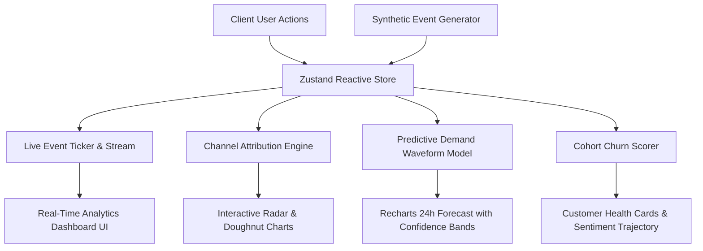

# ⚡ PULSE — Real-Time Event Tracking & Predictive Demand Intelligence

[](https://nextjs.org/)
[](https://www.typescriptlang.org/)
[](https://tailwindcss.com/)
[](./LICENSE)
[]()

> **Pulse** is a cyber-ergonomic, real-time customer event intelligence platform built to eliminate the 24–48 hour attribution lag in modern growth marketing. It unifies live clickstream telemetry, multi-touch attribution matrices, proactive churn early-warning scoring, and Fourier-smoothed predictive demand wave projections.

---

## 📌 Submission & Hand-in Deliverables

All required submission items are included in this public repository:

| Deliverable | Location | Description |
| :--- | :--- | :--- |
| **Problem Statement** | [`PROBLEM_STATEMENT.md`](./PROBLEM_STATEMENT.md) | Exhaustive analysis explaining who has the problem (Growth, Product, RevOps) and why it matters. |
| **Pitch Deck (PPTX)** | [`Pulse_Pitch_Deck.pptx`](./Pulse_Pitch_Deck.pptx) | Professional 9-slide widescreen (16:9) presentation in Microsoft PowerPoint format. |
| **Pitch Deck (Web & PDF)** | [`PITCH_DECK.html`](./PITCH_DECK.html) | Interactive slide deck with print-to-PDF styles (`@media print`). |
| **Clean Documentation** | [`README.md`](./README.md) | Architectural breakdown, feature index, setup instructions, and deployment guide. |
| **Deployment Guide** | [`DEPLOYMENT.md`](./DEPLOYMENT.md) | Step-by-step instructions for local, Vercel, Docker, and self-hosted deployments. |
| **Licence** | [`LICENSE`](./LICENSE) | Open-source MIT License. |

---

## 🎯 The Problem

1. **Attribution Latency:** Marketers manage $50k–$2M/mo ad budgets across Google, Meta, and TikTok using batch ETL reports with a 24–48 hour delay. As a result, 15%–30% of ad spend is wasted before underperforming campaigns are noticed.
2. **Fragmented Silos:** Web traffic (GA4), product sessions (Mixpanel), and revenue (Stripe) live in separate tools without real-time cross-correlation.
3. **Reactive Churn:** Retention teams only react *after* cancellations occur, missing critical 14-day early warning signs of declining engagement.
4. **Demand Surges:** Static linear models fail during unexpected viral surges or flash promotions, leading to server bottlenecks or stockouts.

---

## 🚀 Novelty & Core Features

- ⚡ **High-Throughput Synthetic Simulation Engine:** Zero-backend live event stream generating user actions (`page_view`, `add_to_cart`, `checkout_completed`, `subscription_renewal`) across 6 acquisition channels.
- 🌊 **Predictive Demand Waveform:** Fourier-smoothed algorithmic projection calculating 24-hour future load curves with 95% statistical confidence envelopes.
- 🎯 **Dynamic Attribution Radar & Heatmap:** Multi-touch conversion intensity matrix illuminating high-affinity user segments and peak engagement windows.
- 🛡️ **Proactive Churn Radar:** Customer health scoring engine flagging at-risk accounts based on decaying event cadence and sentiment drop-offs.
- 🎮 **Real-Time Interactive Controls:** Ability to pause/resume simulation, trigger simulated traffic bursts with particle confetti celebrations, and filter by channel or cohort.

---

## 🏗️ System Architecture



---

## 🛠️ Technology Stack

- **Framework:** Next.js 16.4 (Turbopack, App Router)
- **Language:** TypeScript 5.0
- **Styling:** Tailwind CSS v4 + Glassmorphism & Cyber Aesthetics
- **State Management:** Zustand (reactive high-frequency event store)
- **Visualizations:** Recharts & Canvas Confetti
- **Animations:** Framer Motion & CSS hardware-accelerated transforms
- **Icons:** Lucide React

---

## 🏁 Quick Start & Setup Guide

### 1. Clone & Install
```bash
git clone https://github.com/Meera2926/pulse-dashboard.git
cd pulse-dashboard
npm install
```

### 2. Run Development Server
```bash
npm run dev
```
Open **`http://localhost:3000`** in your browser.

### 3. Authentication
The application includes a demo authentication route guard. On first launch, navigate to `/login` and click **"Quick Demo Login"** or input any credentials.

### 4. Build for Production
```bash
npm run build
npm run start
```

---

## 🐳 Docker Run Guide

```bash
# Build Docker image
docker build -t pulse-dashboard .

# Run Docker container
docker run -p 3000:3000 pulse-dashboard
```

---

## 📄 License

This project is licensed under the MIT License — see the [LICENSE](./LICENSE) file for details.
